# Active Directory Lab – Windows Server 2022

## Project Overview

This project demonstrates how to install, configure and manage Active Directory Domain Services (AD DS) using Windows Server 2022 and Windows 11 Pro.

The lab was created using Oracle VirtualBox to practise common IT administration tasks performed by IT Support Technicians and Service Desk Analysts.

The project focuses on Windows Server administration, Active Directory configuration, domain joining, Group Policy, organisational units, user accounts and security groups.

## Technologies Used

- Windows Server 2022
- Windows 11 Pro
- Oracle VirtualBox
- Active Directory Domain Services (AD DS)
- DNS Server
- Group Policy Management
- Active Directory Users and Computers (ADUC)
- Windows Command Prompt

## Lab Environment

| Component | Configuration |
|---|---|
| Domain Controller | Windows Server 2022 |
| Client Computer | Windows 11 Pro |
| Virtualisation | Oracle VirtualBox |
| Server Hostname | DC-LAB |
| Domain Name | jslab.local |
| Server IP Address | 192.168.1.226 |
| Subnet Mask | 255.255.255.0 |
| Client Preferred DNS | 192.168.1.226 |
| Windows 11 Computer Name | WIN11 |

**Network Note:** The Windows Server was using DHCP when the network configuration was captured. A domain controller should have a stable IP address, normally through static configuration or a DHCP reservation.

---

# Part 1: Active Directory Setup

## Step 1: Check Windows Server Network Configuration

Before installing Active Directory, the Windows Server must have a working network connection.

A domain controller should have a stable IP address so that other computers can communicate with it reliably.

### Steps

1. Open Windows Server 2022 in Oracle VirtualBox.
2. Open Command Prompt.
3. Enter the following command:

```cmd
ipconfig /all
```

4. Check the server IP address, subnet mask, default gateway and DNS settings.
5. Confirm the server is connected to the correct VirtualBox network.

The server IP address observed in this lab was `192.168.1.226`.

### Screenshot 01 — Windows Server Network Configuration

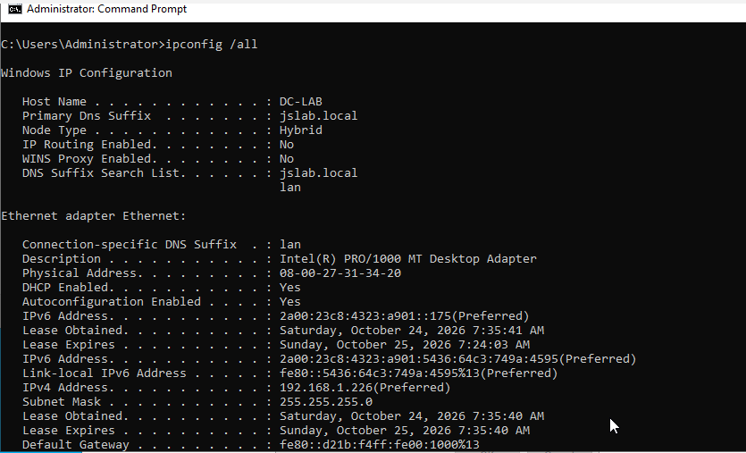

This screenshot shows the Windows Server network information using the `ipconfig /all` command.

---

## Step 2: Open Windows Server Manager

Server Manager is used to configure and manage Windows Server roles and features.

### Steps

1. Open Server Manager.
2. Select Local Server.
3. Review the server name, domain and network configuration.
4. Confirm the Windows Server operating system is running correctly.

### Screenshot 02 — Windows Server Manager

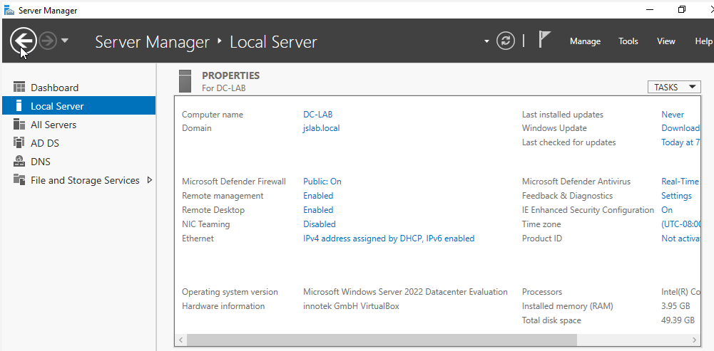

This screenshot shows Windows Server 2022 running in Oracle VirtualBox, with the server details displayed in Server Manager.

---

## Step 3: Install Active Directory Domain Services

Active Directory Domain Services allows administrators to centrally manage domain users, computers and security settings.

### Steps

1. Open Server Manager.
2. Click Manage.
3. Select Add Roles and Features.
4. Select Role-based or feature-based installation.
5. Select the local Windows Server.
6. Select Active Directory Domain Services.
7. Click Add Features when prompted.
8. Continue through the installation wizard.
9. Click Install.

The DNS Server role is also required for Active Directory domain name resolution.

### Screenshot 03 — Installed Server Roles

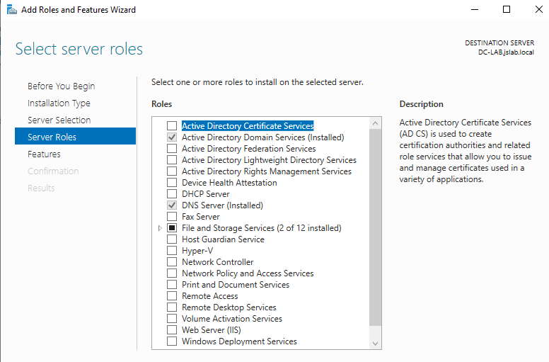

This screenshot shows Active Directory Domain Services and DNS Server listed as installed server roles.

---

## Step 4: Promote Windows Server to a Domain Controller

After installing Active Directory Domain Services, the server must be promoted to a domain controller.

### Steps

1. Open Server Manager.
2. Click the notification flag.
3. Select Promote this server to a domain controller.
4. Select Add a new forest.
5. Enter the domain name:

```text
jslab.local
```

6. Leave DNS Server and Global Catalog selected.
7. Create a Directory Services Restore Mode (DSRM) password.
8. Review the configuration.
9. Complete the prerequisite checks.
10. Click Install.

The server restarts after the domain controller promotion process.

### Screenshot 04 — Active Directory Server Configuration

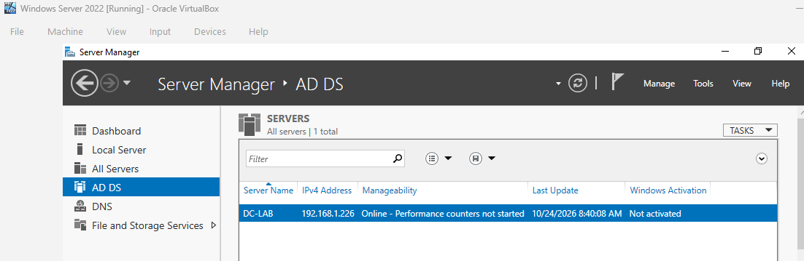

This screenshot shows Active Directory Domain Services in Server Manager after installation and configuration.

---

## Step 5: Verify the Domain Controller

After configuring Active Directory, verify the domain controller.

### Steps

1. Open Command Prompt on Windows Server.
2. Enter:

```cmd
echo %LOGONSERVER%
```

3. Check the returned server name.

The command returned:

```text
\\DC-LAB
```

This identifies the logon server used by the current Windows session.

### Screenshot 05 — Domain Controller Verification

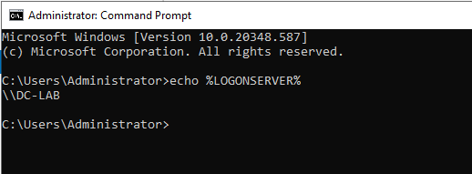

This screenshot shows the Windows logon server verification command.

---

## Step 6: Verify DNS Server Configuration

DNS is an important part of Active Directory because domain computers use it to locate domain controllers and other network services.

### Steps

1. Open Server Manager.
2. Select Tools.
3. Open DNS.
4. Expand the server.
5. Expand Forward Lookup Zones.
6. Select `jslab.local`.
7. Review the DNS records associated with the domain.

### Screenshot 06 — DNS Server Configuration

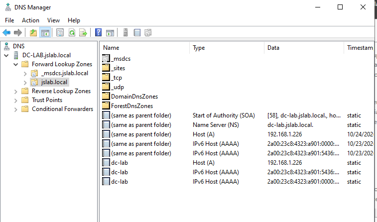

This screenshot shows DNS Manager with the `jslab.local` forward lookup zone and domain-related DNS records.

---

## Step 7: Verify Active Directory Users and Computers

Active Directory Users and Computers is used to manage users, computers, groups and organisational units.

### Steps

1. Open Server Manager.
2. Select Tools.
3. Open Active Directory Users and Computers.
4. Expand the `jslab.local` domain.
5. Confirm that the Active Directory containers are available.

### Screenshot 08 — Active Directory Verification

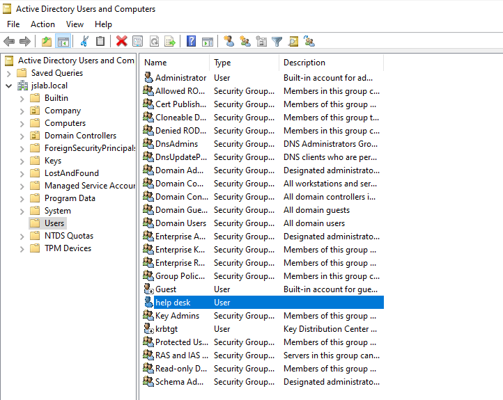

This screenshot shows Active Directory Users and Computers with the `jslab.local` domain and its containers.

---

# Part 2: Windows 11 Domain Join

This section demonstrates how to connect a Windows 11 computer to the Active Directory domain.

## Step 1: Prepare Windows 11

A Windows 11 Pro virtual machine was used as the client computer.

### Steps

1. Create a Windows 11 Pro virtual machine using Oracle VirtualBox.
2. Connect the virtual machine to the same accessible network as the domain controller.
3. Start Windows 11.
4. Confirm the client can communicate with Windows Server.

Windows 11 Pro supports joining an Active Directory domain.

---

## Step 2: Configure Windows 11 DNS

The Windows 11 client must use the domain controller's DNS server to locate Active Directory services.

### Steps

1. Open Windows 11 Settings.
2. Navigate to Network & Internet.
3. Open the network connection properties.
4. Select DNS server assignment.
5. Change the setting to Manual.
6. Enable IPv4.
7. Enter the domain controller IP address:

```text
192.168.1.226
```

8. Save the settings.

### Screenshot 09 — Windows 11 DNS Configuration

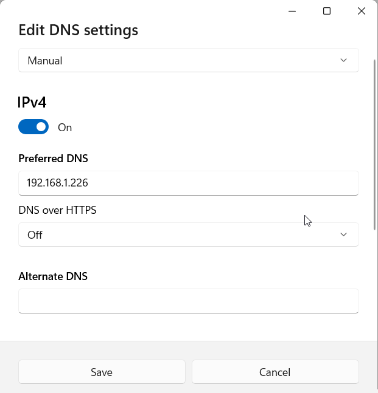

This screenshot shows Windows 11 configured to use the domain controller as its preferred DNS server.

---

## Step 3: Join Windows 11 to Active Directory

### Steps

1. Press Windows + R.
2. Enter:

```cmd
sysdm.cpl
```

3. Select the Computer Name tab.
4. Click Change.
5. Select Domain.
6. Enter:

```text
jslab.local
```

7. Enter authorised domain administrator credentials when prompted.
8. Complete the domain join process.
9. Restart Windows 11.

After joining the domain, Windows 11 becomes part of the Active Directory environment.

### Screenshot 10 — Windows 11 Domain Membership

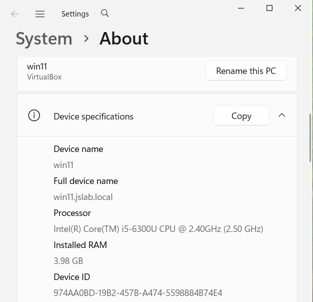

This screenshot shows the Windows 11 computer with the full device name `win11.jslab.local`.

---

## Step 4: Verify the Computer in Active Directory

After joining Windows 11 to the domain, its computer account should appear in Active Directory.

### Steps

1. Open Active Directory Users and Computers.
2. Expand `jslab.local`.
3. Select Computers.
4. Locate the Windows 11 computer account.

### Screenshot 11 — Active Directory Computer Verification

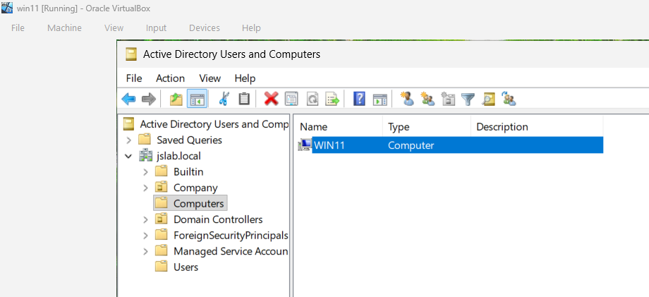

This screenshot shows the `WIN11` computer object registered in Active Directory.

---

## Step 5: Log In Using a Domain Account

After joining Windows 11 to the domain, users can sign in using Active Directory accounts.

Example account:

```text
JSLAB\helpdesk
```

### Steps

1. Start Windows 11.
2. Sign in using the domain user account.
3. Open Command Prompt.
4. Enter:

```cmd
whoami
```

The command should display the domain and username.

Example result:

```text
jslab\helpdesk
```

### Screenshot 12 — Windows 11 Domain Login

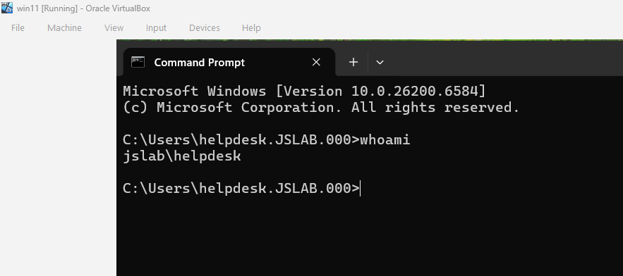

This screenshot shows a successful Windows 11 domain user session verified using the `whoami` command.

---

# Part 3: Group Policy Management

Group Policy allows administrators to manage Windows settings across domain users and computers.

This section covers creating a Group Policy Object, configuring a restriction, linking the policy to an organisational unit and testing the result.

## Step 1: Open Group Policy Management

### Steps

1. Open Server Manager.
2. Click Tools.
3. Select Group Policy Management.
4. Expand Forest: jslab.local.
5. Expand Domains.
6. Select `jslab.local`.

---

## Step 2: Create a Group Policy Object

### Steps

1. Expand Group Policy Objects.
2. Right-click Group Policy Objects.
3. Select New.
4. Enter the policy name:

```text
Desktop Lockdown Policy
```

5. Click OK.

### Screenshot 13 — Group Policy Object Creation

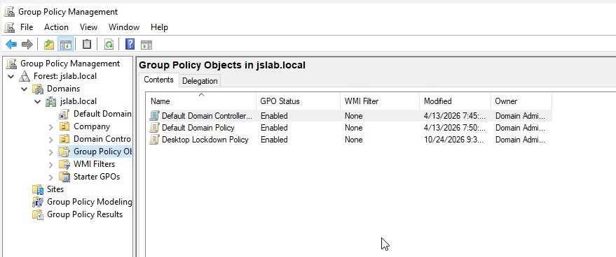

This screenshot shows the Desktop Lockdown Policy listed in Group Policy Management.

---

## Step 3: Configure Group Policy Settings

The Desktop Lockdown Policy is designed to restrict access to Control Panel and Windows Settings for selected test users.

### Steps

1. Right-click Desktop Lockdown Policy.
2. Select Edit.
3. Navigate to:

```text
User Configuration
    └── Policies
        └── Administrative Templates
            └── Control Panel
```

4. Open Prohibit access to Control Panel and PC settings.
5. Select Enabled.
6. Click Apply.
7. Click OK.

### Screenshot 14 — Group Policy Settings

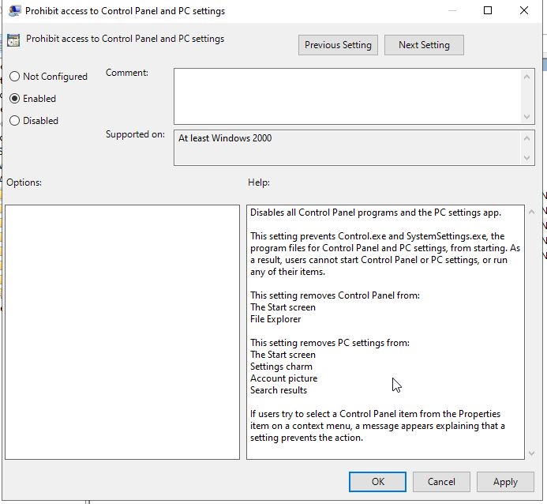

This screenshot shows the Control Panel restriction configured as Enabled.

---

## Step 4: Link the GPO to an Organisational Unit

Group Policy Objects must be linked to the appropriate domain, site or organisational unit for their settings to apply.

### Steps

1. Open Group Policy Management.
2. Expand `jslab.local`.
3. Expand Company.
4. Select the GPO-Test OU.
5. Right-click the OU.
6. Select Link an Existing GPO.
7. Select Desktop Lockdown Policy.
8. Click OK.

The linked policy should appear under Linked Group Policy Objects.

### Screenshot 15 — GPO Linked to an OU

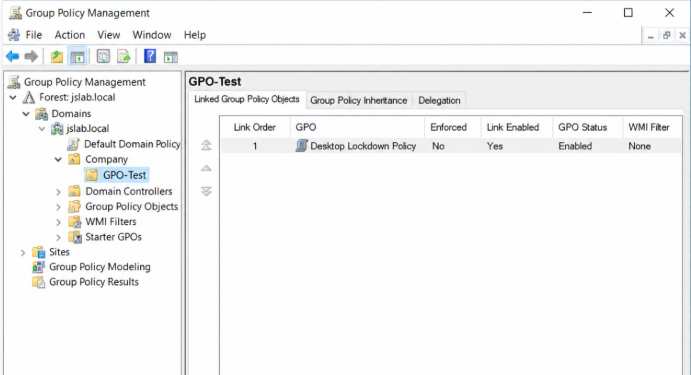

*Illustrative example showing Desktop Lockdown Policy linked to the GPO-Test organisational unit.*

---

## Step 5: Apply and Verify Group Policy

Once the policy has been linked to an OU containing the intended test user, it can be tested on Windows 11.

### Steps

1. Sign in to Windows 11 using an appropriate domain test account.
2. Open Command Prompt.
3. Run:

```cmd
gpupdate /force
```

4. Sign out and sign back in if required.
5. Run:

```cmd
gpresult /r
```

6. Check whether Desktop Lockdown Policy appears in the applied user policies.
7. Attempt to open Control Panel.

If the restriction has been applied successfully, Windows should prevent the user from opening Control Panel.

### Screenshot 16 — Group Policy Verification

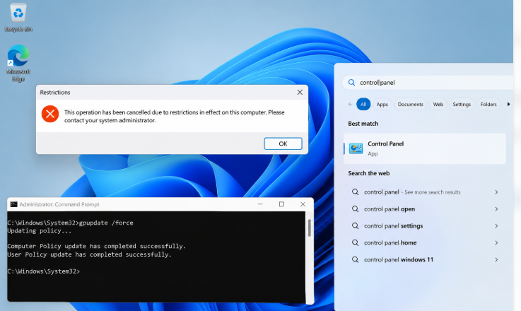

*Illustrative example showing a Group Policy refresh and a Windows restriction message. This is not a verified test result from the actual lab.*

---

# Part 4: Organisational Units (OUs)

Organisational Units help administrators organise Active Directory users, groups and computers.

They can also be used to apply Group Policy settings to specific departments and delegate administration.

## Step 1: Create Organisational Units

### Steps

1. Open Active Directory Users and Computers.
2. Expand `jslab.local`.
3. Right-click the domain.
4. Select New → Organizational Unit.
5. Enter the OU name.
6. Click OK.
7. Repeat for additional departments.

### Example OU Structure

```text
jslab.local
│
└── Company
    ├── Finance
    ├── HR
    ├── IT
    └── GPO-Test
```

### Screenshot 17 — Active Directory OU Structure

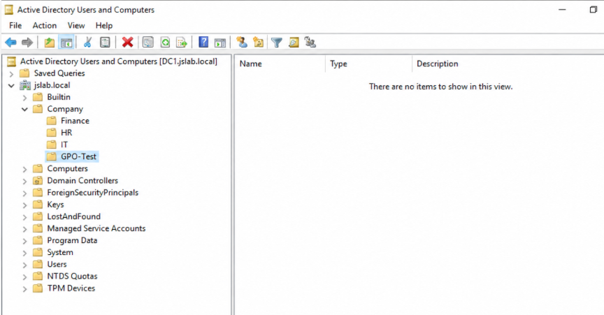

*Illustrative example showing departmental OUs under Company.*

---

## Step 2: Organise Users Within an OU

Users can be placed into departmental OUs to make account management easier.

### Steps

1. Open Active Directory Users and Computers.
2. Expand `jslab.local`.
3. Expand Company.
4. Select the relevant department, such as HR.
5. Create a user inside the OU or move an existing user into it.
6. Verify that the user appears in the correct OU.

### Screenshot 18 — Users Within an OU

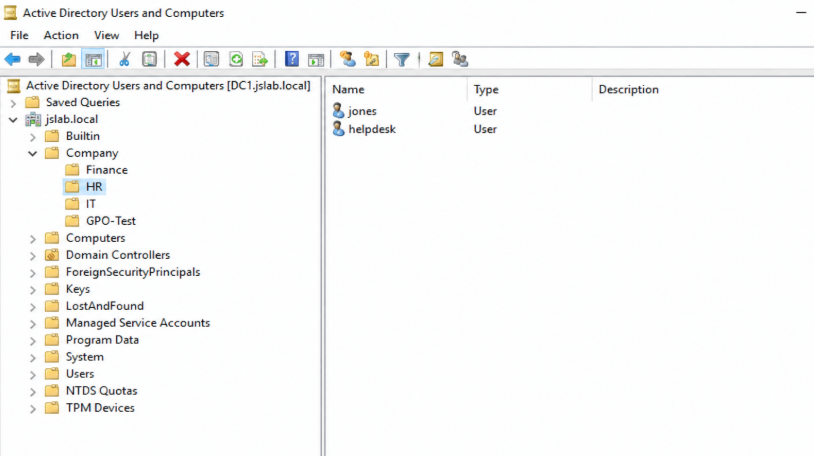

*Illustrative example showing user accounts organised within the HR OU.*

---

# Part 5: User and Group Management

This section covers common Active Directory administration tasks, including user account creation, security group configuration and group membership management.

## Step 1: Create an Active Directory User Account

### Steps

1. Open Active Directory Users and Computers.
2. Expand `jslab.local`.
3. Open Company → HR.
4. Right-click the HR OU.
5. Select New → User.
6. Enter the account details.

### Example User Account

| Field | Value |
|---|---|
| First Name | James |
| Last Name | Smith |
| Username | jsmith |
| Domain | jslab.local |
| Department | HR |

7. Click Next.
8. Create a temporary password.
9. Select User must change password at next logon, if appropriate.
10. Complete the wizard.
11. Open the user account properties to review the details.

### Screenshot 19 — Active Directory User Account

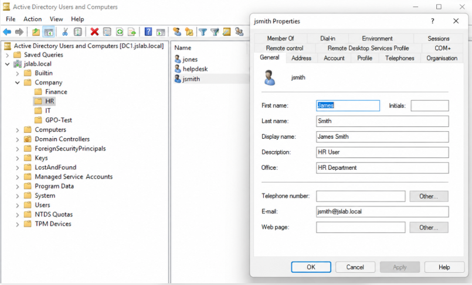

*Illustrative example showing the properties of the jsmith user account within the HR OU.*

---

## Step 2: Create a Security Group

Security groups allow administrators to manage permissions and access for multiple users.

### Steps

1. Open Active Directory Users and Computers.
2. Navigate to Company → HR.
3. Right-click the HR OU.
4. Select New → Group.
5. Enter the group name:

```text
HR-Staff
```

6. Select Global as the group scope.
7. Select Security as the group type.
8. Click OK.

### Screenshot 20 — Active Directory Security Group

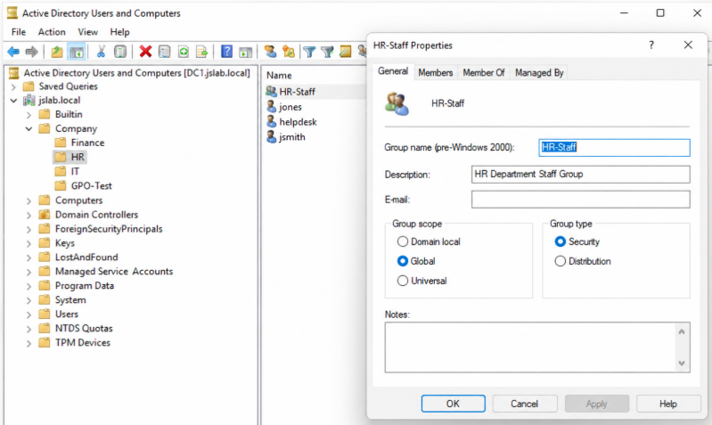

*Illustrative example showing HR-Staff configured as a Global Security group.*

---

## Step 3: Add a User to a Security Group

### Steps

1. Open Active Directory Users and Computers.
2. Navigate to the HR OU.
3. Double-click HR-Staff.
4. Select the Members tab.
5. Click Add.
6. Enter the username:

```text
jsmith
```

7. Click Check Names.
8. Click OK.
9. Click Apply.
10. Verify that the user appears in the Members list.

### Screenshot 21 — Security Group Membership

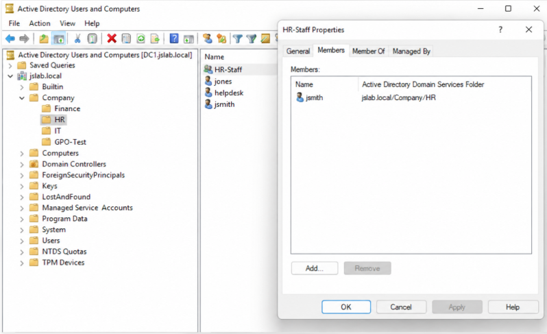

*Illustrative example showing jsmith as a member of the HR-Staff security group.*

---

# Project Summary

This Active Directory lab provides a foundation for understanding Windows Server administration and common Active Directory support tasks.

The project covers Windows Server setup, Active Directory installation, Windows 11 domain membership, Group Policy configuration, organisational units, user accounts and security groups.

## Skills Covered

- Windows Server 2022 administration
- Virtual machine setup using Oracle VirtualBox
- Windows network configuration
- Active Directory Domain Services installation
- Domain controller configuration
- DNS configuration and verification
- Windows 11 domain joining
- Domain user authentication
- Active Directory Users and Computers
- Organisational Unit management
- Group Policy Object creation and configuration
- Security group management
- User account administration
- Windows command-line verification

## Screenshot Documentation

The project contains 20 screenshot references across five sections.

| Section | Screenshots | Total |
|---|---|---|
| Part 1 — Active Directory Setup | 01–06, 08 | 7 |
| Part 2 — Windows 11 Domain Join | 09–12 | 4 |
| Part 3 — Group Policy Management | 13–16 | 4 |
| Part 4 — Organisational Units | 17–18 | 2 |
| Part 5 — User and Group Management | 19–21 | 3 |
| **Total** | | **20** |

**Evidence Note:** Some screenshots are illustrative examples rather than genuine captures from the live lab. These are identified in their captions. They demonstrate the intended configuration but should not be treated as proof that the corresponding actions were completed in the virtual machines.

## Future Improvements

The following practical exercises are planned to expand the project:

- [ ] Replace illustrative screenshots with genuine lab captures
- [ ] Configure a static IP address or DHCP reservation for the domain controller
- [ ] Practise Active Directory password resets
- [ ] Practise unlocking user accounts
- [ ] Simulate new employee onboarding
- [ ] Simulate employee offboarding
- [ ] Troubleshoot domain login problems
- [ ] Troubleshoot DNS resolution problems
- [ ] Troubleshoot Group Policy application issues
- [ ] Document practical service desk support tickets
- [ ] Practise user account disabling and re-enabling
- [ ] Add verification commands and test results

---

**Project Status:** Active Directory lab foundation documented, with additional hands-on verification and service desk exercises planned.

*This project forms part of my wider IT Support and Helpdesk portfolio, focusing on practical skills relevant to 1st Line IT Support and Service Desk Analyst positions.*
