# IT Support Helpdesk – Ticketing Systems Lab

## Project Overview

This project explores three IT Service Management (ITSM) platforms used by IT support teams:

- ServiceNow
- Freshservice
- Jira Service Management

The project focuses on common 1st Line IT Support scenarios, including password resets, Active Directory account lockouts, employee onboarding, Outlook email issues, printer troubleshooting and access requests.

The aim is to understand how helpdesk tickets are created, prioritised, assigned, investigated, documented and resolved.

> **Project evidence notice:** The ServiceNow and Freshservice screenshots are AI-generated examples. The Jira screenshots are third-party reference material. These images demonstrate example ticketing workflows and are not presented as evidence of completed hands-on tasks.

---

## Skills and Knowledge Covered

- IT helpdesk and service desk operations
- ITIL incident management concepts
- Incident and service request handling
- Ticket categorisation and prioritisation
- Active Directory account administration
- Password reset and account unlock procedures
- Employee onboarding and access management
- Microsoft Outlook troubleshooting
- Hardware and printer support
- Service Level Agreements (SLAs)
- Customer communication
- Internal work notes
- Ticket escalation and resolution documentation

---

# 1. ServiceNow – Incident Management

ServiceNow is an ITSM platform used to manage incidents, service requests and IT support workflows.

This section contains three example incidents.

## Ticket 1 – Active Directory Account Lockout

**Incident:** INC0010045  
**Priority:** 4 – Low  
**Category:** Software  
**Status shown:** New

### Issue

A user cannot sign in to a Windows 11 workstation after entering the wrong password multiple times.

The account may be locked in Active Directory.

### Lab Environment Referenced

- Windows Server 2022
- Domain: `jslab.local`
- Domain controller: `DC-LAB`
- Windows 11 workstation: `WIN11`
- User account: `jslab\helpdesk`

### Investigation and Troubleshooting

The example work notes describe the following process:

1. Verify the user's identity.
2. Open Active Directory Users and Computers.
3. Locate the affected user account.
4. Check whether the account is locked.
5. Unlock the account and reset the password if required.
6. Ask the user to test their login.

### Outcome

The work notes describe a successful login following the account unlock and password reset.

However, the screenshot still shows the incident status as New. It therefore does not demonstrate a consistently completed ticket.

### Screenshot

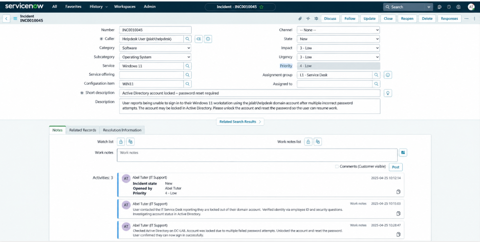

---

## Ticket 2 – New Employee Onboarding

**Incident:** INC0010056  
**Priority:** 2 – Medium  
**Status shown:** Resolved

### Issue

A new employee joining the Finance department requires access to company systems before their start date.

### Systems and Access Requested

- Active Directory account
- Finance security group
- Email account
- VPN access
- SAP financial system access
- Configured laptop

### Work Notes and Resolution

The example describes:

1. Creating a new Active Directory user account.
2. Adding the employee to the Finance security group.
3. Configuring email access.
4. Setting up VPN access.
5. Preparing a laptop with the required software.
6. Checking access to the requested systems.

### Outcome

The screenshot shows the ticket marked Resolved with work notes and resolution information.

### Screenshot

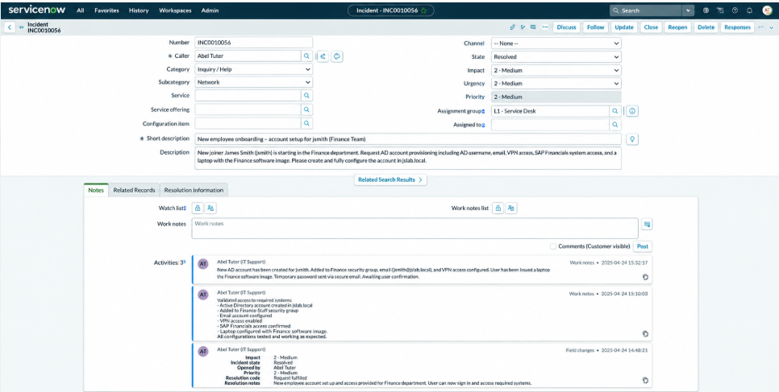

---

## Ticket 3 – Microsoft Outlook Not Receiving Emails

**Incident:** INC0010078  
**Priority:** 3 – Moderate  
**Category:** Software / Email  
**Service:** Microsoft Outlook  
**Status shown:** New

### Issue

A user reports that Outlook has stopped receiving emails.

Other employees are unaffected, and the user can still access emails through Outlook Web Access.

### Investigation and Troubleshooting

The example work notes describe:

1. Checking Outlook connectivity.
2. Confirming that webmail is working.
3. Investigating mailbox storage.
4. Identifying a mailbox close to its storage limit.
5. Archiving older emails to free space.
6. Restarting Outlook.
7. Checking whether email synchronisation resumes.

### Outcome

The activity history describes the issue as resolved after freeing mailbox space.

However, the main incident status still shows New, so the screenshot does not provide consistent evidence of a completed ticket.

### Screenshot

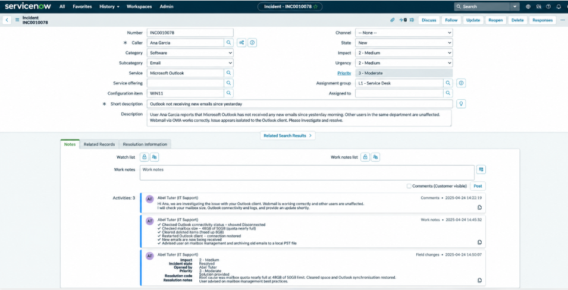

---

# 2. Freshservice – IT Helpdesk Incident Management

Freshservice is an ITSM platform used to manage IT incidents, service requests, assets and support workflows.

This section illustrates the complete lifecycle of a password reset incident.

## Ticket 1 – Active Directory Password Reset

**Incident:** INC-3  
**Category:** Access & Accounts  
**Subcategory:** Password Reset  
**Priority:** Medium  
**Source:** Email  
**Assigned group:** IT Support  
**Final example status:** Resolved

### Issue

A user contacts the IT Support team because they have forgotten their password and cannot access their account.

The example follows three stages.

## Stage 1 – New Ticket

The first screenshot shows:

- A new password reset incident.
- The original request from the user.
- Medium priority.
- Ticket categorisation.
- Acknowledgement from the IT Support team.
- Ticket status set to New.

### Screenshot 1 – Initial Request

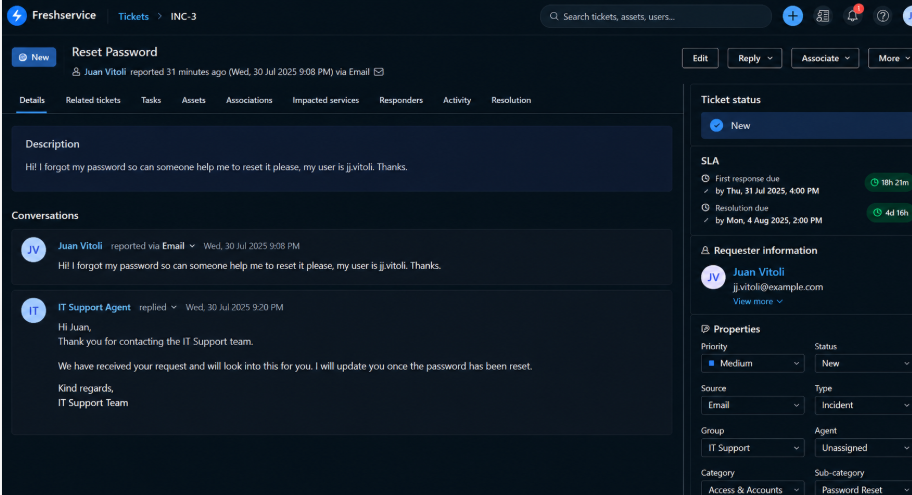

---

## Stage 2 – Investigation and Troubleshooting

The second screenshot illustrates the investigation process.

### Actions Documented

1. Review the user's account in Active Directory.
2. Check the account status.
3. Record the password reset in private work notes.
4. Require a password change at the next login.
5. Inform the user through the support ticket.

**Status shown:** In Progress

### Screenshot 2 – Investigation

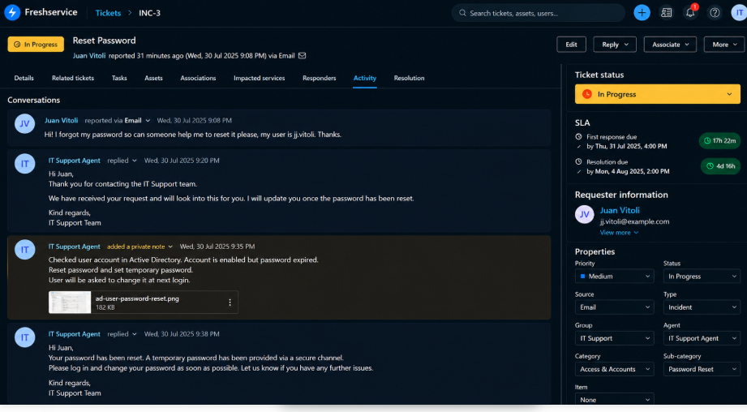

---

## Stage 3 – Resolution

The third screenshot illustrates the final stage of the incident.

### Resolution Details

- Password reset documented.
- User confirms successful login.
- User confirms their password has been changed.
- IT Support records the outcome.
- Ticket marked Resolved.
- SLA indicators shown as met.

### Screenshot 3 – Resolved Ticket

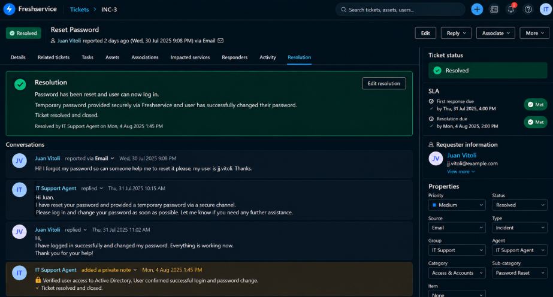

### Ticket Lifecycle

New → In Progress → Resolved

### Learning Outcome

This example demonstrates how a helpdesk incident progresses from the original request through investigation and customer communication to resolution.

It also highlights the importance of verifying user identity and using approved secure password reset methods.

---

# 3. Jira Service Management – IT Support Requests

Jira Service Management is an ITSM platform used for managing incidents, service requests, ticket queues, approvals and SLAs.

This section contains two reference ticket scenarios.

## Ticket 1 – Printer Not Printing

**Ticket:** NDIV-4  
**Request type:** Hardware Issue  
**Priority:** High  
**Status shown:** Open

### Issue

A user in the Accounting department reports that print jobs remain stuck in the queue when printing to a shared office printer.

The printer is powered on, and other users may also be affected.

### Business Impact

- Urgency: High
- Business impact: Moderate / Limited
- Affected equipment: Shared printer

## Screenshot 1 – Customer Portal

This screenshot shows the printer issue reported through the customer portal.

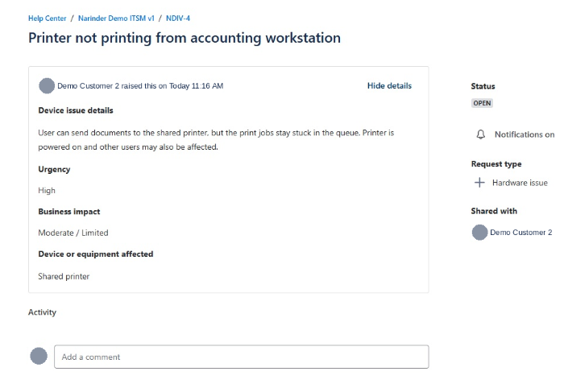

## Screenshot 2 – IT Support Agent View

This screenshot shows the agent's view of the ticket, including:

- Ticket description
- Assigned IT Support Agent
- Priority
- Request type
- Hardware classification

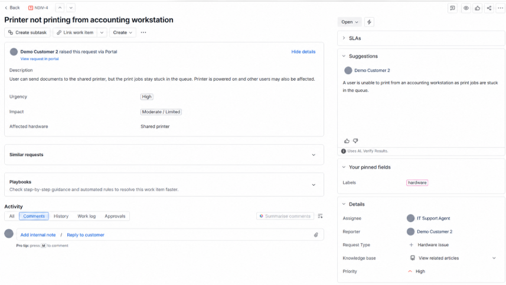

## Screenshot 3 – SLA Tracking

This screenshot shows the ticket's first-response and resolution SLA targets.

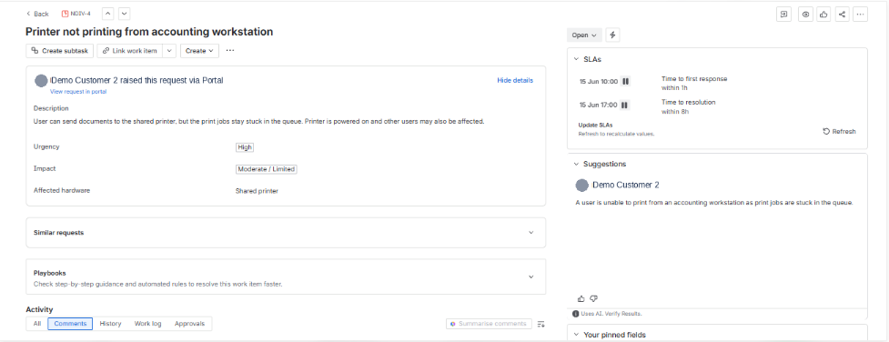

### Learning Outcome

This scenario demonstrates:

- Hardware incident reporting
- Ticket assignment
- Priority management
- SLA monitoring
- Customer and agent ticket views

**Resolution status:** The screenshots do not show troubleshooting actions or a completed resolution.

---

## Ticket 2 – New Employee Access Request

**Ticket:** NDIV-6  
**Request type:** New User Access Request  
**Priority:** Medium  
**Status shown:** Waiting for Support

### Issue

A manager requests account and system access for a new employee starting the following week.

### Access Requested

- Windows login / computer account
- Microsoft 365 / Email
- Shared drive / file access

### Request Details

- Urgency: Medium
- Business impact: Moderate / Limited
- Approver: Demo Manager
- Assigned to: IT Support Agent

## Screenshot 1 – Access Request Form

The first screenshot shows the form used to submit an employee access request.

It includes fields for:

- Employee details
- Access requirements
- Business justification
- Urgency
- Business impact
- Manager approval

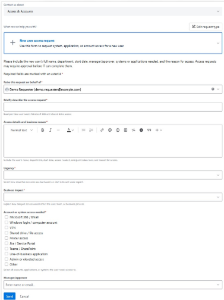

## Screenshot 2 – Customer Ticket

The second screenshot shows the submitted request in the customer portal.

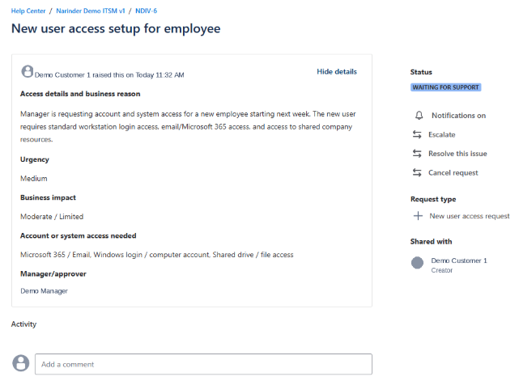

## Screenshot 3 – IT Support Agent View

The third screenshot shows how the IT Support Agent reviews the request.

It includes the required systems, approver, priority and assigned agent.

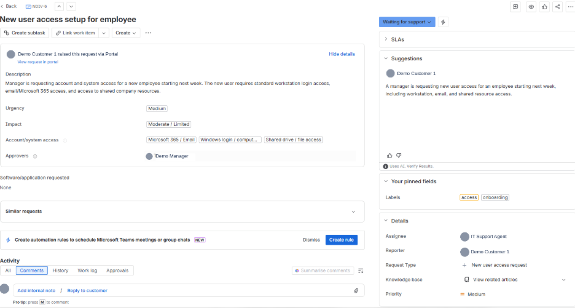

### Learning Outcome

This scenario demonstrates:

- Service request management
- User onboarding requirements
- Access request documentation
- Approval workflows
- Ticket assignment
- Customer communication

**Resolution status:** The ticket remains Waiting for Support. No completed account provisioning or access verification is shown.

---

# 4. Ticketing Platform Comparison

| Feature | ServiceNow | Freshservice | Jira Service Management |
|---|---|---|---|
| Incident management | Yes | Yes | Yes |
| Service requests | Yes | Supported | Yes |
| Ticket priorities | Yes | Yes | Yes |
| Work notes | Yes | Yes | Supported |
| Customer communication | Yes | Yes | Yes |
| SLA management | Supported | Yes | Yes |
| Resolution documentation | Illustrated | Illustrated | Not shown |
| Agent assignment | Yes | Yes | Yes |

---

# 5. Summary of Ticket Scenarios

| Platform | Ticket | Scenario | Screenshot Status |
|---|---|---|---|
| ServiceNow | INC0010045 | AD Account Lockout | New |
| ServiceNow | INC0010056 | Employee Onboarding | Resolved |
| ServiceNow | INC0010078 | Outlook Email Issue | New |
| Freshservice | INC-3 | Password Reset | Resolved |
| Jira | NDIV-4 | Printer Issue | Open |
| Jira | NDIV-6 | New User Access | Waiting for Support |

**Total: 6 ticket scenarios and 12 screenshots.**

---

# 6. What I Learned

By reviewing these example workflows, I developed a better understanding of:

1. How service desk tickets are structured.
2. The difference between incidents and service requests.
3. How urgency and business impact affect priority.
4. How support agents record troubleshooting steps.
5. Why internal notes and customer updates are important.
6. How SLAs are used to track response and resolution targets.
7. How Active Directory tasks relate to helpdesk tickets.
8. Why successful resolution should be confirmed before closing a ticket.

---

# 7. Future Hands-On Lab Development

The next stage is to recreate these scenarios in actual practice environments.

Planned tasks include:

- Creating and resolving ServiceNow incidents.
- Completing Active Directory account unlock and password reset exercises.
- Recording real Freshservice work notes and resolutions.
- Creating Jira tickets and documenting troubleshooting steps.
- Testing user access after account provisioning.
- Capturing genuine screenshots of completed work.
- Replacing illustrative screenshots with actual lab evidence.

---

# 8. Disclaimer

This repository is an educational collection of IT helpdesk ticketing examples.

ServiceNow and Freshservice screenshots are AI-generated illustrative examples. Jira screenshots are third-party reference material and should be attributed to their original creator.

These examples are not presented as authentic production tickets or proof of independently completed IT support work.

No real customer credentials or confidential business information should be included in a public repository.
