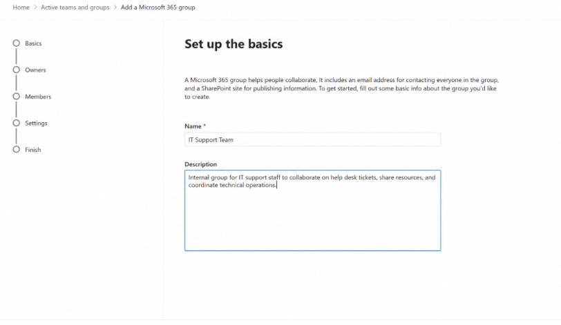
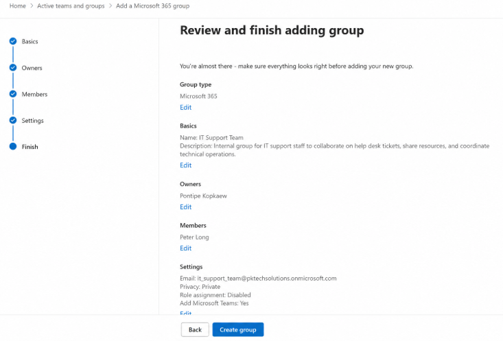
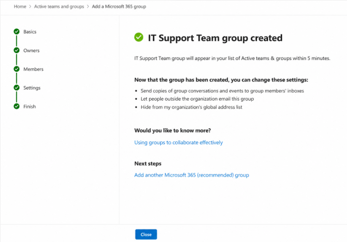
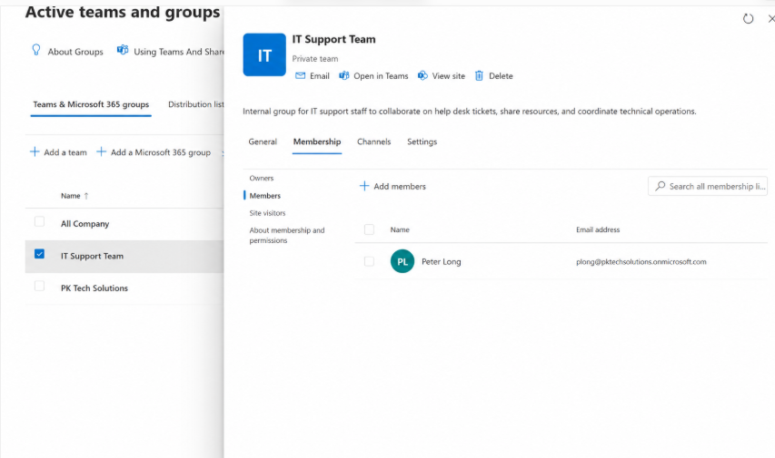
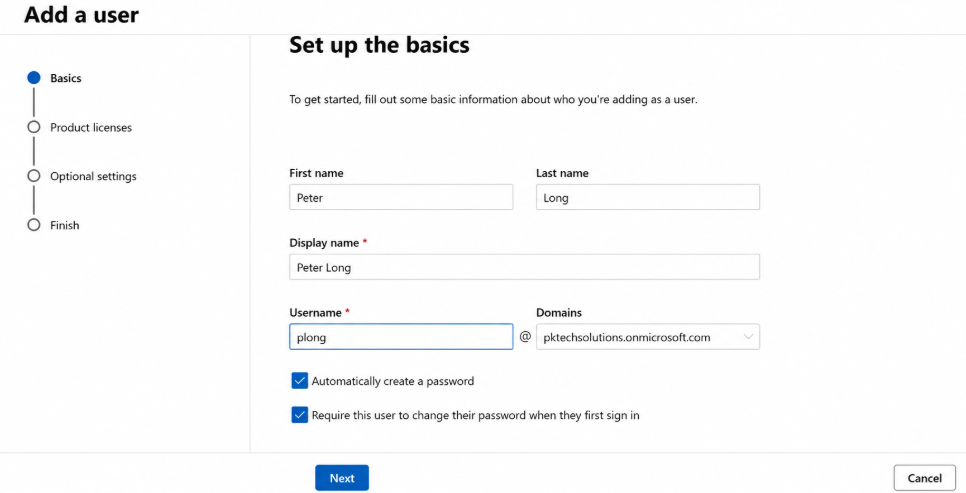
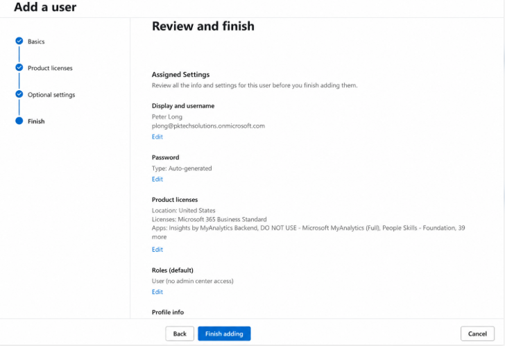
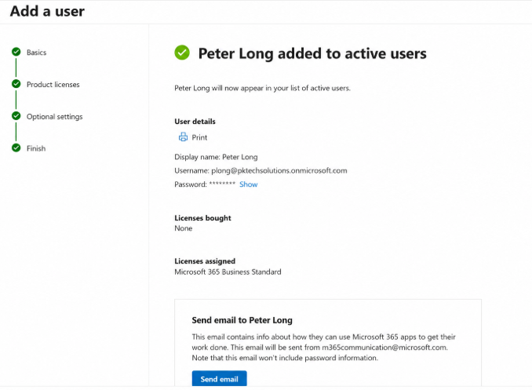
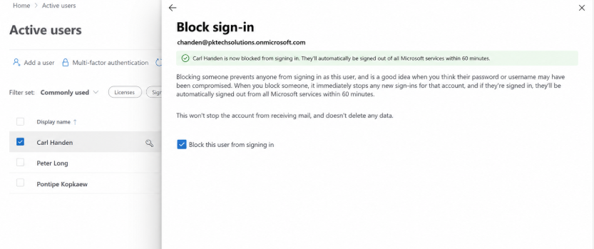
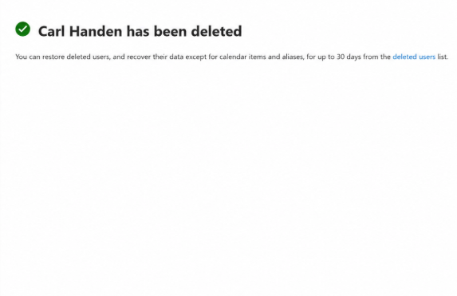
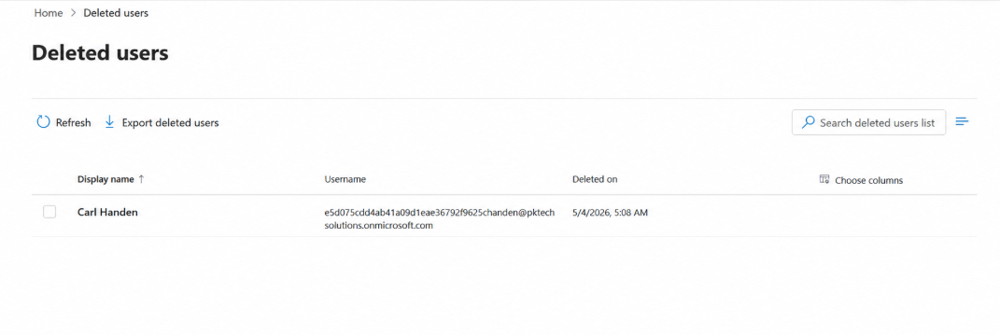

# Microsoft 365 Admin Lab

## Overview

This project documents my practical experience using the Microsoft 365 Admin Centre to perform common IT support administration tasks.

The lab covers Microsoft 365 group management, user account creation, licence configuration, blocking user sign-in and deleting user accounts.

I completed three administration exercises and documented them using 10 screenshots.

These tasks are relevant to 1st Line IT Support, Service Desk Analyst and IT Administrator roles.

---

## Table of Contents

1. [Task 1 - Create a Microsoft 365 Group and Add a Member](#task-1---create-a-microsoft-365-group-and-add-a-member)
2. [Task 2 - Create a Microsoft 365 User](#task-2---create-a-microsoft-365-user)
3. [Task 3 - Block Sign-in and Delete a User](#task-3---block-sign-in-and-delete-a-user)
4. [Skills Demonstrated](#skills-demonstrated)
5. [Conclusion](#conclusion)

---

## Lab Environment

- **Platform:** Microsoft 365 Admin Centre
- **Focus:** User and group administration
- **Tasks Completed:** 3
- **Screenshots:** 10

---

## Task 1 - Create a Microsoft 365 Group and Add a Member

### Objective

Create a Microsoft 365 group called **IT Support Team**, review its settings and add **Peter Long** as a member.

### Steps Completed

1. Opened the Microsoft 365 Admin Centre.
2. Navigated to the group management section.
3. Created a Microsoft 365 group called IT Support Team.
4. Reviewed the group owner, members and configuration.
5. Confirmed the group was successfully created.
6. Added Peter Long to the group.
7. Verified that Peter Long appeared in the membership list.

### Screenshot 01 - Create Microsoft 365 Group

Entered the details required to create the IT Support Team group.

### Screenshot 02 - Group Configuration

Reviewed the group owner, members and configuration settings.

### Screenshot 03 - Group Created

Confirmed that the IT Support Team group was successfully created.

### Screenshot 04 - Group Membership

Verified that Peter Long was added as a member of the IT Support Team group.

### Result

Successfully created the IT Support Team group, reviewed its configuration and verified the required group membership.

**Skills demonstrated:** Microsoft 365 group management, group configuration and membership administration.

---

## Task 2 - Create a Microsoft 365 User

### Objective

Create a new Microsoft 365 user account for **Peter Long** and review the account settings and Microsoft 365 Business Standard licence.

### Steps Completed

1. Opened the Microsoft 365 Admin Centre.
2. Navigated to the user management section.
3. Selected the option to create a new user.
4. Entered Peter Long's account information.
5. Configured the password options.
6. Reviewed the account permissions.
7. Reviewed the Microsoft 365 Business Standard licence.
8. Completed the account creation process.
9. Verified that the new user account was created successfully.

### Screenshot 05 - Create User

Entered Peter Long's account details and password options.

### Screenshot 06 - Review User

Reviewed the account details, permissions and Microsoft 365 Business Standard licence.

### Screenshot 07 - User Created

Confirmed that Peter Long's Microsoft 365 user account was successfully created.

### Result

Successfully created a Microsoft 365 user account and reviewed its settings and licence configuration.

**Skills demonstrated:** User provisioning, account management, password configuration and Microsoft 365 licensing.

---

## Task 3 - Block Sign-in and Delete a User

### Objective

Complete a user offboarding exercise by blocking **Carl Handen** from signing in, deleting the account and verifying its deletion.

### Steps Completed

1. Opened the Microsoft 365 Admin Centre.
2. Located Carl Handen's user account.
3. Opened the account settings.
4. Blocked the user from signing in.
5. Confirmed that sign-in was blocked.
6. Deleted the user account.
7. Opened the Deleted Users section.
8. Verified that Carl Handen's account appeared in the deleted users list.

### Screenshot 08 - User Sign-in Blocked

Blocked Carl Handen from signing in to Microsoft 365.

### Screenshot 09 - User Deleted

Completed the deletion of Carl Handen's account.

### Screenshot 10 - Deleted User Verified

Confirmed that Carl Handen's account appeared in the Deleted Users section.

### Result

Successfully blocked user sign-in, deleted the account and verified its deletion.

**Skills demonstrated:** User offboarding, account security, access management and user deletion.

---

## Screenshot Summary

| Task | Screenshots | Description |
|---|---|---|
| Task 1 | 01-04 | Group creation and membership management |
| Task 2 | 05-07 | User provisioning and licence configuration |
| Task 3 | 08-10 | Blocking sign-in and account deletion |
| **Total** | **10** | **Three administration exercises** |

---

## Skills Demonstrated

Through this lab, I have practised:

- Microsoft 365 Admin Centre navigation
- Microsoft 365 group creation
- Group membership management
- User account creation and provisioning
- Password configuration
- Microsoft 365 licence administration
- User permissions and access control
- Blocking user sign-in
- User account deletion
- User offboarding
- Verifying administrative actions
- Documenting completed tasks with screenshots

---

## Relevance to IT Support

These exercises reflect common tasks carried out by IT Support Technicians and Service Desk Analysts.

**Employee onboarding:** Creating new user accounts, configuring access and managing group membership.

**Account administration:** Reviewing user details, permissions and Microsoft 365 licences.

**Employee offboarding:** Blocking access, deleting accounts and confirming that changes have been applied.

**Technical documentation:** Recording administration tasks and providing screenshots as evidence.

---

## Conclusion

This Microsoft 365 Admin Lab demonstrates my practical learning in Microsoft 365 user management, group administration and user offboarding.

Completing these exercises has helped me develop the skills needed for entry-level IT Support and Service Desk roles.

The 10 screenshots document the administration tasks and provide supporting evidence of the work completed.
